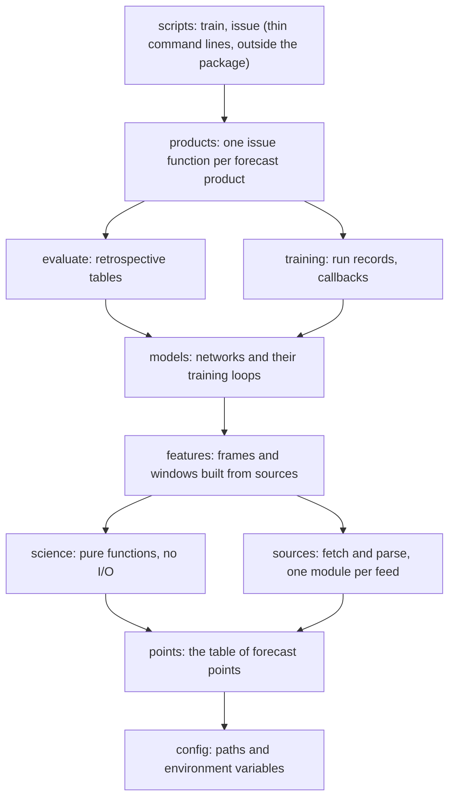
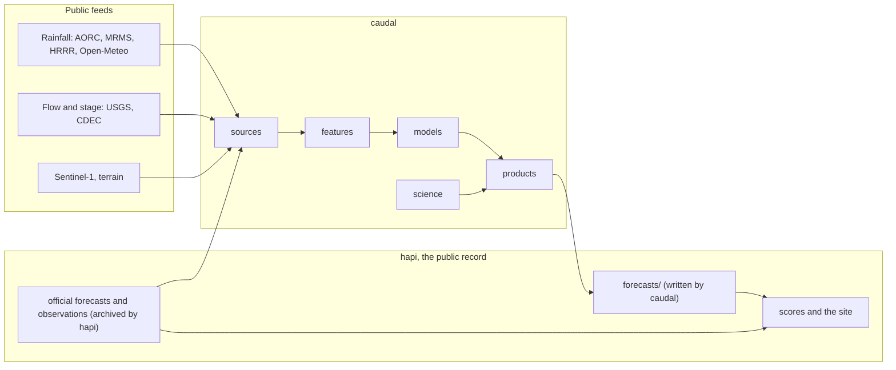

# Architecture

Status: proposal, written 2026-11-15, not yet approved. Nothing in this page is built unless the
"Today" column says so. Approving this page is the gate before any module moves.

caudal is the forecasting package. It turns rainfall and river observations into probabilistic
forecasts of river flow, reservoir inflow and flood extent, and writes them as files into
[hapi](https://github.com/sotarolab/hapi), the public record that archives the official forecasts
and scores everything against observations. caudal forecasts; hapi keeps score.

## The four rules

**One path.** The function that issues today's forecast for a point is the function a backtest
calls for a day last year. A product has one entry, `issue(point, as_of)`, and both the scheduled
job and the retrospective evaluation go through it. Today the live path is `scripts/issue.py` and
the retrospective path is `caudal/evaluate.py`; they share the model and the frames but not the
entry, and closing that gap is the first restructuring step.

**Issued once, never revised.** A forecast is written before its outcome exists and is not
touched again. Each model is frozen before it issues: its weights file, the commit that trained
it and its inputs are recorded in a manifest beside its forecasts. A changed model is a new
product with a new name.

**A point is a row.** Adding a reservoir or a gauge is one entry in `points.py` (identifier,
kind, coordinates, basin, thresholds), not new code. Anything that loops over points reads that
table.

**The science is written by a person.** The functions in `caudal/science/` carry the method: the
loss, the scores, the map logic, the resampling. Their bodies are written by the repository's
owner. Claude writes their signatures, docstrings and tests, and everything outside that folder,
under the process in `CLAUDE.md`.

## Layers

Each layer imports only from layers below it. `science` and `sources` sit side by side and do
not import each other: science never does I/O, and a source never computes a result.

The contract will live in `.importlinter` and run in `make qc`, as in camanchaca, so an import
that reaches upward fails the build. It is added in the same pull request that moves the modules.

## Layout

| Path | Holds | Today |
|---|---|---|
| `caudal/config.py` | Paths; `CAUDAL_DATA` and `HAPI_DATA` | Exists |
| `caudal/points.py` | The forecast points: 15 reservoir points now (11 trained and scored), 12 flood gauges to add | Exists (reservoirs) |
| `caudal/sources/openmeteo.py` | Daily forcing at a point, archive and forecast | Exists as `forcing.py` |
| `caudal/sources/cw3e.py` | The CW3E atmospheric-river catalog | Exists as `data/cw3e.py` |
| `caudal/sources/ledger.py` | Read observations from hapi; write forecasts in the file contract | Split between `frames.py` and `scripts/issue.py` |
| `caudal/sources/usgs.py` | Hourly flow and stage | New |
| `caudal/sources/aorc.py`, `mrms.py`, `hrrr.py` | Basin-mean hourly rainfall: analysis, radar, forecast | New |
| `caudal/sources/sentinel1.py`, `hand.py`, `boundaries.py` | Radar scenes, height above nearest drainage, polygons | New |
| `caudal/science/quantile.py` | Pinball loss; exceedance probability from quantiles | Loss exists in `models/quantile_lstm.py` |
| `caudal/science/scores.py` | CRPS, coverage, and the agreement scores for maps | CRPS exists as `scores.py` |
| `caudal/science/extent.py` | Stage to flood extent; flooded area in a polygon | New |
| `caudal/science/water.py` | Water mask from radar backscatter | New |
| `caudal/science/bootstrap.py` | Block bootstrap for the index bounds | New |
| `caudal/science/routing.py` | Kinematic-wave or Muskingum-Cunge routing, as a baseline | New |
| `caudal/features/frames.py`, `windows.py` | Model inputs, daily and hourly | Exist as `frames.py`, `models/sequence.py` |
| `caudal/models/quantile_lstm.py` | The quantile LSTM and its training loop | Exists |
| `caudal/training/` | Run records and callbacks | Exists |
| `caudal/evaluate.py` | Retrospective skill tables | Exists |
| `caudal/products/inflow_daily.py` | Daily reservoir inflow, leads 1 to 14 days | Logic in `scripts/issue.py` |
| `caudal/products/flow_hourly.py` | Hourly flow at the flood gauges | New |
| `caudal/products/extent.py` | Flood extent and flooded-area index at Guerneville | New |
| `scripts/train.py`, `scripts/issue.py` | Command lines over the package | Exist |
| `tests/` | Mirrors the package; `tests/science/` holds the approved tests of the core | Three test files today |
| `docs/` | This site: architecture, the method with its math, references, decisions | This page |

Modules move one layer per pull request, with the tests green at each step.

## Data flow

## The contract with hapi

caudal and hapi share files, not code. hapi never imports caudal: the scorer is independent of
the forecaster it scores, the way a referee does not borrow a player's rulebook. caudal's own
scores are checked against hapi's on shared fixtures in a test.

- **Forecast file (exists):** `forecasts/<model>/<point>/<issue date>.csv`, one row per target
  day, columns `date`, `lead`, then one column per quantile (`q05` to `q95`), in cfs.
- **Hourly forecast file (proposed):** `forecasts/<model>/<point>/<issue time>.csv`, one row per
  target hour, columns `valid_time`, `lead_h`, then the quantiles.
- **Model manifest (proposed):** `forecasts/<model>/MODEL.json`: the model name, the caudal
  commit, the SHA-256 of the weights file, the quantiles, the training window, the forcing, and
  the date it was frozen. hapi refuses a forecast whose model has no manifest.
- **Observations (exists):** caudal reads observed inflow from hapi's `data/` directory, so both
  sides score against the same numbers.

## The core, written by a person

The functions an expert reader would ask about first. Claude scaffolds each one (signature,
docstring with the equation and its reference, failing tests) and does not write the body.

| Function | File | Reference to cite |
|---|---|---|
| Pinball loss | `science/quantile.py` | Koenker and Bassett (1978) |
| Exceedance probability from quantiles | `science/quantile.py` | To be chosen with the interpolation rule |
| CRPS of an ensemble, coverage | `science/scores.py` | Hersbach (2000); Ferro (2014) for the fair form |
| Agreement scores for a map (CSI, POD, FAR) | `science/scores.py` | Standard contingency-table definitions |
| Stage to extent; flooded area | `science/extent.py` | Height above nearest drainage: Rennó et al. (2008), Nobre et al. (2011) |
| Radar water mask | `science/water.py` | To be chosen with the threshold method |
| Block bootstrap | `science/bootstrap.py` | Künsch (1989) |
| Routing baseline | `science/routing.py` | Cunge (1969) |
| Quantile head and windowing | `models/quantile_lstm.py`, `features/windows.py` | Kratzert et al. (2019) for the LSTM setup |

The references are from memory and are checked against the papers before they enter
`docs/references.md`. Any hydrodynamic or routing method used here must be a published one.

## What scalability means here

- A new point is a row; a new feed is one module in `sources`; a new product is one module in
  `products`.
- Every job can be run again for the same date and writes the same files.
- No result exists only in a notebook. A number is a row written by a script at a commit.
- No server, queue or database is added until a feature needs one. The package runs from a
  scheduled job and writes files.

## Questions for the reviewer

1. **Is the core list right?** The proposal protects `caudal/science/` and the network class.
   A narrower choice is `science/` only.
2. **The CRPS that exists today** in `scores.py` was written by Claude. Rewrite it yourself, or
   review it line by line and adopt it?
3. **One repo or two for the map work?** This page keeps the satellite and terrain code inside
   caudal (`sources/sentinel1.py`, `science/extent.py`). The alternative is a separate package;
   the cost of keeping it here is heavier dependencies (rasterio, geopandas) as an optional extra.
4. **The conda environment** is still named `embalse`. Rename it to `caudal`?
5. **Package name on PyPI.** `caudal` was free on 2026-11-15. Publish a first version once the
   daily product issues from CI, to hold the name?
